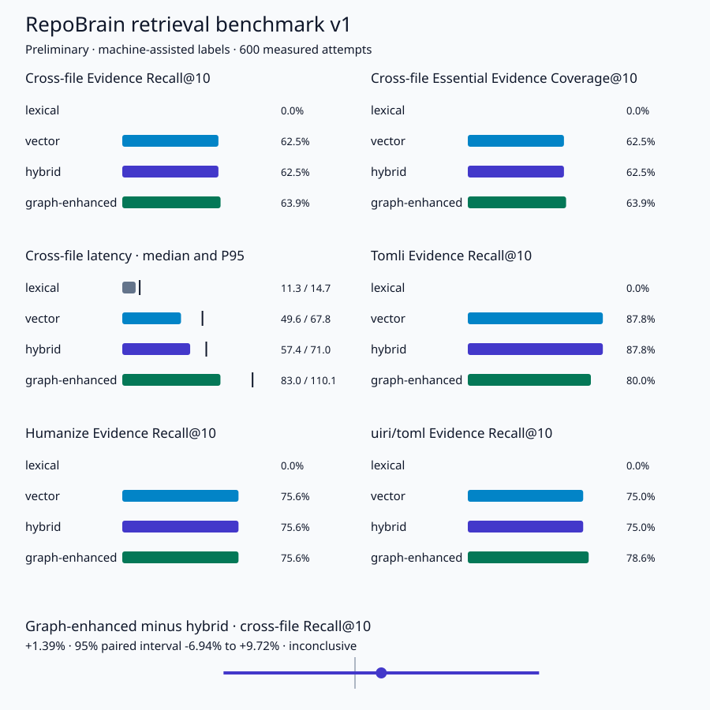

# Commit-pinned retrieval benchmark v1

These results are preliminary. The annotations are machine-assisted and
await independent review. The benchmark covers 50 questions across three
pinned repositories. Forty-four are answerable, including 24 cross-file
questions. The nine development questions are separate.

All four production retrievers ran sequentially on the same PostgreSQL
snapshots and pinned CPU ONNX model. The seeded schedule ran one warm-up
pass and three measured passes. The report uses the first successful
measured ranking for quality metrics. All 600 measured requests succeeded.

## Cross-file results

Regenerate the plots from the saved summary with
`python evaluation/plot_run.py`.

| Method | Evidence Recall@10 | Essential file coverage@10 | Median ms | P95 ms |
| --- | ---: | ---: | ---: | ---: |
| Lexical | 0.00% | 0.00% | 11.28 | 14.73 |
| Vector | 62.50% | 62.50% | 49.63 | 67.76 |
| Hybrid RRF | 62.50% | 62.50% | 57.37 | 71.00 |
| Graph-enhanced | 63.89% | 64.58% | 82.96 | 110.11 |

Graph-enhanced minus hybrid cross-file Recall@10 was +1.39 percentage
points, with a paired 95% bootstrap interval of −6.94 to +9.72 points
over 24 questions. Median cross-file latency increased by 25.59 ms.
Across all 44 answerable questions, graph-enhanced Recall@10 was 78.03%,
compared with 79.55% for hybrid. These results do not establish an
advantage over hybrid. Whole-question lexical matching returned no
judged evidence in this workload. That result is specific to the existing
lexical query policy and these natural-language questions.

## Repository breakdown

| Repository | Answerable questions | Lexical | Vector | Hybrid RRF | Graph-enhanced |
| --- | ---: | ---: | ---: | ---: | ---: |
| Tomli | 15 | 0.00% | 87.78% | 87.78% | 80.00% |
| Humanize | 15 | 0.00% | 75.56% | 75.56% | 75.56% |
| uiri/toml | 14 | 0.00% | 75.00% | 75.00% | 78.57% |

Values are mean Evidence Recall@10. The same measured results show that
graph expansion helped locate ordinary time-token grammar and dispatch
(`b1-11`, +⅓ recall), localized number words (`b2-11`, +½), and public
serialization and nested traversal (`b3-05`, +½). It hurt signed timezone
offset evidence (`b1-09`, −½) and localization activation evidence
(`b2-07`, −½). These are ranked-evidence regressions, and all corresponding
requests succeeded.

## Development-only lexical diagnosis

The unchanged lexical service returned zero hits for all nine development
questions. Source-derived symbol probes for those questions returned
10, 3, 2, 3, 9, 10, 10, 10 and 3 hits respectively, capped at ten.
The SQL builds a PostgreSQL plain-text query that conjoins its normalized
terms. A chunk must match every term. The contrast is consistent with
prose introducing required terms that occur outside the evidence or do
not occur in the source. These probes demonstrate index behavior and
were not used to change the frozen protocol.

## Run integrity

Run `python evaluation/audit_run.py` from the checkout to verify the
frozen hashes, run binding, manifest and raw export counts and to
regenerate the per-repository table. The raw export contains 800 unique
question, mode and repetition keys, including 200 warm-ups and 600
measured attempts. The recorded implementation is
`e36d670231f1d491bec4aa6783873dfb3b46d7b8`.

Two repositories implement TOML, and questions within each repository
are dependent. The bootstrap resamples question pairs, so its interval
does not capture generalization to new repositories. Unjudged chunks
receive zero relevance gain. This run does not measure answer quality.

The [protocol](evaluation.md), [review export](../evaluation/benchmark-v1-review.md),
[freeze manifest](../evaluation/datasets/benchmark-v1-freeze.json), and
[machine-readable results](../evaluation/results/run-01-summary.json)
describe the inputs and contain per-question observations.

## Answer workflow verification

The [development export](../evaluation/results/development-answers/review.jsonl)
contains 36 blinded cases from the production answer service with a keyless
loopback fixture. There were 27 fixture responses with structurally valid
citations, nine lexical abstentions, and zero errors. The fixture did not
report token usage. It verifies integration and export behavior. Semantic
quality requires independent human scoring.

## Local-model development run

Ollama 0.40.19 ran Qwen2.5 1.5B Q4_K_M (`65ec06548149`) on CPU through
the production OpenAI-compatible answer pipeline with a keyless loopback
endpoint and a 120-second request timeout. The nine frozen development
questions ran in all four retrieval modes. No benchmark questions were
used for this generation run.

| Retrieval mode | Accepted answers | No-evidence abstentions | Invalid generation output | Timeouts |
| --- | ---: | ---: | ---: | ---: |
| Lexical | 0 | 9 | 0 | 0 |
| Vector | 3 | 0 | 4 | 2 |
| Hybrid | 4 | 0 | 3 | 2 |
| Graph-enhanced | 2 | 0 | 6 | 1 |

Among nine accepted answers, median generation latency was 52.89 seconds
(range 16.85–96.37 seconds). Ollama reported 1,029–3,634 input tokens and
160–442 output tokens for those nine cases. These latency and usage figures
exclude failures and no-evidence abstentions. The
[blinded export](../evaluation/results/local-model-development/review.jsonl)
contains 18 review cases, with rubric scores left blank. The local method key
records all 36 cases, including failures. Keep it separate during review.
Citations on accepted answers passed structural validation. Semantic support,
correctness, and completeness still require independent review. This small
development run does not establish a quality difference between methods.

The [release review](release-review.md) records claim-level engineering
observations and the limits of retrospective failure classification.
